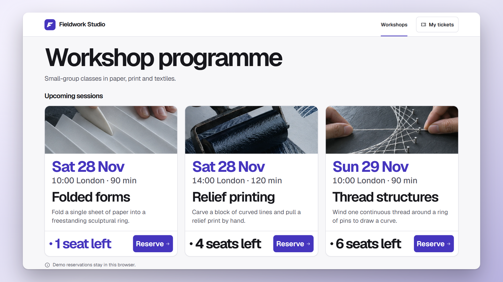

# Fieldwork Workshop Booking

Import this repository into v0 to get an editable studio booking app. In **Preview**, choose **Reserve → Confirm reservation**. Refresh the Preview, open **My tickets**, select the ticket and choose **Cancel reservation → Release seat**. Demo tickets stay in this browser. [Import from GitHub](https://v0.app/docs/git-import) · [Try the standalone Fieldwork demo](https://fieldwork-studio-gallery-w15.vercel.app)



## Try a first edit

> Show the materials for each class beneath its description in the programme. Use the catalogue's materials field and style the line for both themes. Keep the Reserve buttons visible on mobile.

In your preview, check the materials on the three workshop cards. Reserve a seat and open **My tickets** again. [Catalogue](lib/programme.mjs) · [Programme views](app/studio-programme.jsx) · [Stylesheet](app/style.css)

[Desktop programme](docs/images/programme-1440.png) · [Reservation screen](docs/images/reserve-1440.png) · [Mobile programme](docs/images/mobile-workshops.png) · [Mobile ticket](docs/images/ticket-390.png)

## Add your classes

Fieldwork lists one upcoming date per workshop in chronological order. Add each class to the [catalogue](lib/programme.mjs) with its materials, demo capacity and `offsetHours`, counted from Saturday at 00:00 UTC. Add its `public/studies/<slug>.webp` image and a matching row in the [seed](supabase/seed.sql) with capacity, sample reservations and `offset_hours`. A null database offset makes a workshop a one-off. The [stylesheet](app/style.css) follows the visitor's light or dark preference.

## Run locally or deploy

Use Node.js 24 in the repository root.

```sh
npm ci
npm run dev
```

Open [localhost:3000](http://localhost:3000). The browser demo needs no environment values. The button below deploys a new copy of the original starter outside v0. To deploy your own v0 edits, use your chat’s publishing controls. [v0 deployments](https://v0.app/docs/deployments)

[](https://vercel.com/new/clone?repository-url=https%3A%2F%2Fgithub.com%2Fohad6k%2Ffieldwork-booking-v0&project-name=fieldwork-booking-v0&repository-name=fieldwork-booking-v0&demo-title=Fieldwork%20Studio&demo-description=Browse%20workshops%2C%20book%20a%20seat%20and%20manage%20your%20ticket.&demo-url=https%3A%2F%2Ffieldwork-studio-gallery-w15.vercel.app&demo-image=https%3A%2F%2Fraw.githubusercontent.com%2Fohad6k%2Ffieldwork-booking-v0%2Fmain%2Fdocs%2Fimages%2Ftemplate-preview.png)

## Share availability with Supabase

1. In your v0 project’s **Settings → Integrations**, choose Supabase and connect your project. In Supabase’s SQL Editor, run the [migration](supabase/migrations/20261122222124_workshop_capacity.sql), then the [seed](supabase/seed.sql). [v0 databases](https://v0.app/docs/databases)
2. In **Settings → Environment variables**, check for a project URL and a server secret. Fieldwork accepts `SUPABASE_URL` or `NEXT_PUBLIC_SUPABASE_URL` for the URL, and `SUPABASE_SECRET_KEY` or `SUPABASE_SERVICE_ROLE_KEY` for the server key. Supply a missing value there. For local development, set the same values in `.env.local`. [v0 project settings](https://v0.app/docs/projects)
3. Refresh the v0 Preview after changing its settings. Restart `npm run dev` locally or redeploy if you're working outside the v0 Preview. Guests share the same workshop availability and manage their tickets in the browser where they booked. The booking endpoint accepts guests without sign-in or built-in rate limits. For a public studio, you can rate-limit requests to `/api/booking` in Vercel Firewall. To enforce a per-person allowance, require sign-in. [Vercel rate limiting](https://vercel.com/docs/vercel-firewall/vercel-waf/rate-limiting) · [Supabase Auth](https://supabase.com/docs/guides/auth)

After a recurring class closes, run [reschedule.sql](supabase/reschedule.sql) to schedule its next date from its stored offset. Past tickets keep their dates. You can automate this step with [Supabase Cron](https://supabase.com/docs/guides/cron).

For display, set `STUDIO_LOCALE` and `STUDIO_TIME_ZONE` in [programme.mjs](lib/programme.mjs). The defaults are `en-GB` and `Europe/London`. The schedule stays anchored in UTC, so London displays a class one hour later during British Summer Time.

## Check the last seat

With Docker and Bash, run `bash scripts/test-db.sh` to check last-seat bookings, cancellations and rescheduling. These sequential pgTAP tests exercise the guard in this starter.

Recorded concurrency tests from an unpublished VibeRaven build show two guests taking the last seat in an earlier workshop schema. Fieldwork’s guard held across the tested orders. The public 1.13.0 concurrency check returned **incomplete** on this schema. [Test setup, recording, and results](docs/booking-proof.md)

Run `npm test` for the schedule and London time-label tests and `npm run build` for the production build. `npm run check` reviews the repository. Migration pull requests also run an advisory concurrency check. [CI workflow](.github/workflows/migrations.yml)

## License

[MIT](LICENSE). Geist is distributed under the [SIL Open Font License](public/fonts/OFL-Geist.txt).
